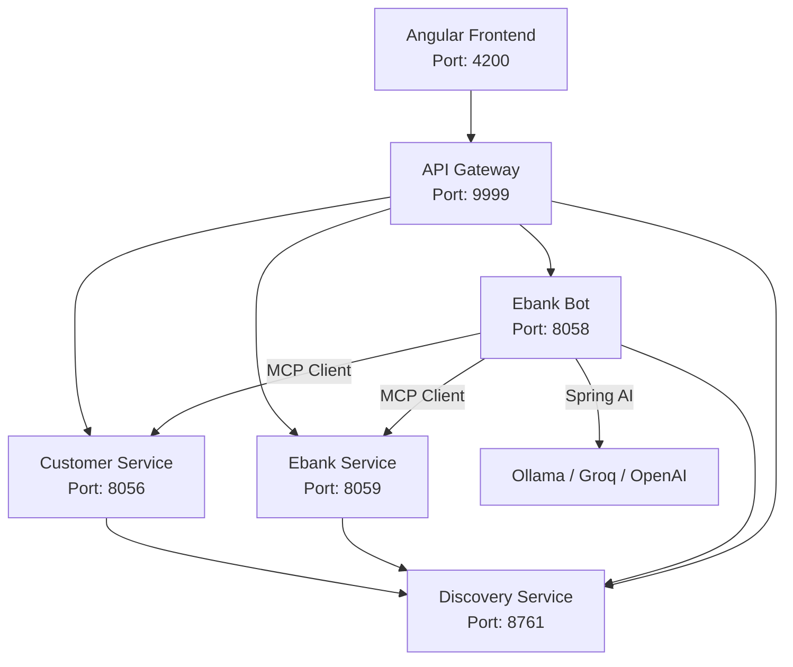
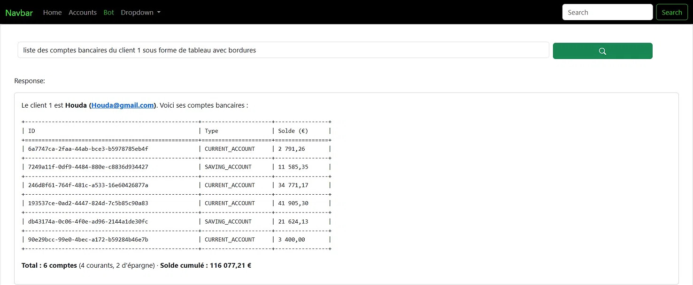
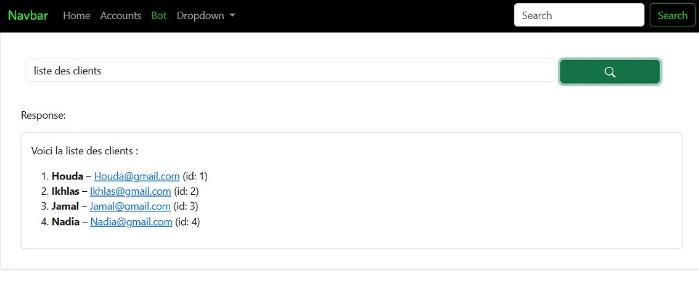
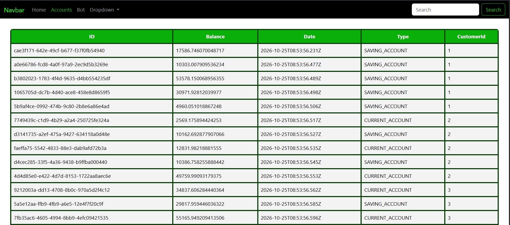
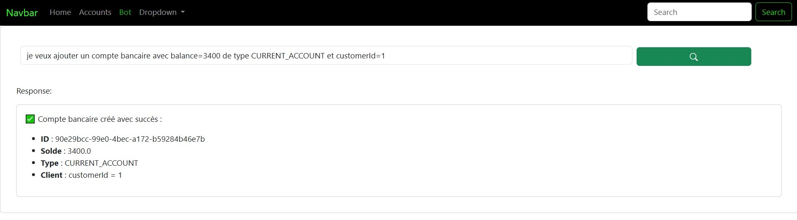
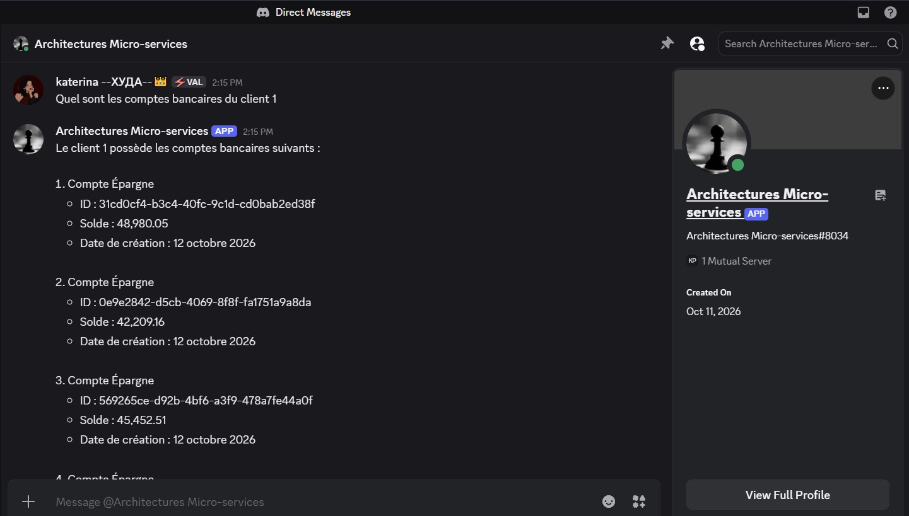
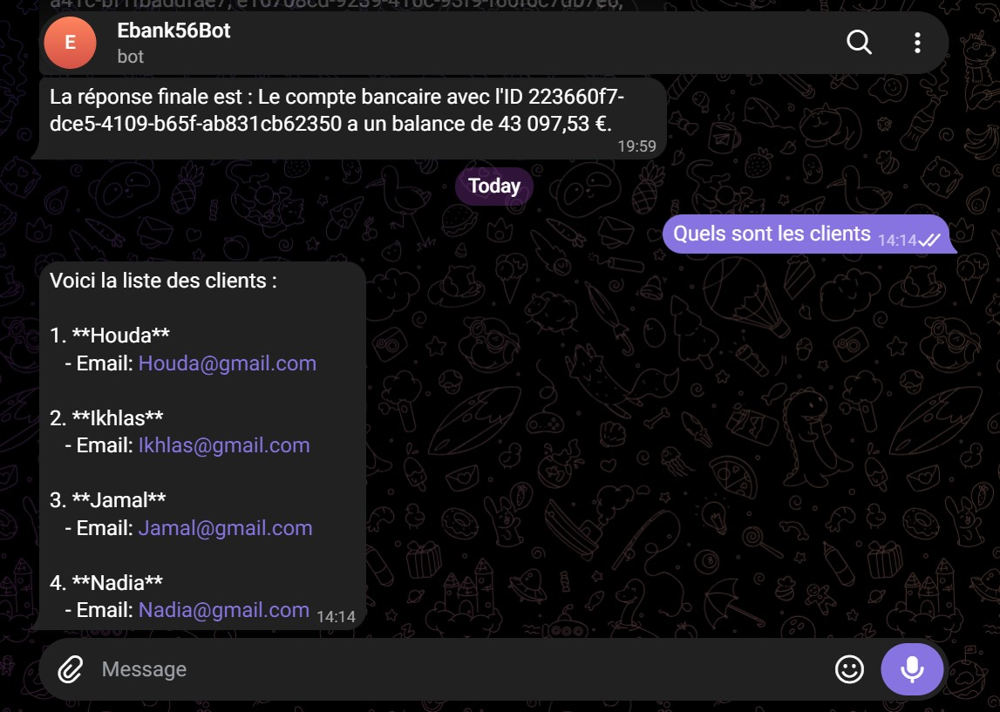

<div align="center">

# 🏦 E-Bank MA - Architecture Microservices & Agentic AI

> Une plateforme bancaire complète combinant Spring Cloud, Spring AI et Angular.

[](#)
[](#)
[](#)
[](#)
[](#)

</div>

---

## 📖 Overview

Ce projet est une application bancaire distribuée construite sur une **architecture microservices**. Il intègre un **Agent Conversationnel Intelligent (Chatbot)** capable d'interagir avec les données bancaires réelles via le protocole **MCP (Model Context Protocol)** et **Spring AI**.

L'objectif est de démontrer comment connecter un LLM (Large Language Model) à des services métiers tout en gardant une architecture découplée.

---

## ✨ Fonctionnalités Principales

*   **Architecture Microservices** : Découpage en services métiers (Clients, Comptes) et services d'infrastructure (Gateway, Discovery).
*   **Service Discovery (Eureka)** : Enregistrement automatique et découverte des services.
*   **API Gateway (Spring Cloud)** : Point d'entrée unique (port 9999) avec gestion du CORS et du routage.
*   **Agent IA (Spring AI + MCP)** : Le bot utilise des outils (Tools) exposés par les microservices pour répondre aux questions (ex: "Liste des clients").
*   **Communication Inter-services** : Utilisation d'OpenFeign et Resilience4j entre les services.
*   **Bots Multi-plateformes** : Intégration de Discord et Telegram.
*   **Frontend Angular** : Interface moderne avec affichage Markdown et streaming des réponses.

---

## 🏗️ Architecture du Projet


### Ports des Services

| Service | Port | Description |
| :--- | :--- | :--- |
| `discovery-service` | 8761 | Serveur Eureka (Service Registry) |
| `gateway-service` | 9999 | Passerelle API (Spring Cloud Gateway) |
| `customer-service` | 8056 | Microservice de gestion des clients (MCP Server) |
| `ebank-service` | 8059 | Microservice de gestion des comptes (MCP Server) |
| `ebank-bot` | 8058 | Agent IA Spring Boot (MCP Client + Chatbot) |
| `angular-front` | 4200 | Application Frontend Angular |

---

## 🚀 Guide de Démarrage

### Prérequis

*   **Java 21** (JDK)
*   **Maven**
*   **Node.js** (v18+) et **npm** pour le frontend
*   **Ollama** (pour l'IA locale) ou une clé API (Groq/OpenAI)

### 1. Lancer le Backend

Ouvrez un terminal dans le dossier racine du projet et compilez :

```bash
mvn clean install
```
Ensuite, démarrez les services dans cet ordre (dans des terminaux séparés ou via IntelliJ IDEA) :

1. `DiscoveryServiceApplication` (Port 8761)
2. `CustomerServiceApplication` (Port 8056)
3. `EbankServiceApplication` (Port 8059)
4. `GatewayServiceApplication` (Port 9999)
5. `EbankBotApplication` (Port 8058)

### 2. Configurer l'IA (ebank-bot)

Le bot peut fonctionner avec **Ollama** (local) ou **Groq** (cloud). Modifiez `ebank-bot/src/main/resources/application.properties` selon votre choix.

**Option A : Ollama (Local)**
```properties
spring.ai.model.chat=ollama
spring.ai.ollama.base-url=http://localhost:11434
spring.ai.ollama.chat.options.model=qwen2.5
```
**Option B : Groq (Cloud - Recommandé pour le Streaming)**
```properties
spring.ai.model.chat=openai
spring.ai.openai.base-url=https://api.groq.com/openai/v1
spring.ai.openai.api-key=${GROQ_API_KEY}
spring.ai.openai.chat.options.model=llama-3.3-70b-versatile
```
### 3. Lancer le Frontend Angular
```bash
cd angular-front
npm install
ng serve
```
L'application sera accessible sur http://localhost:4200

## 🧪 Tester l'Agent IA

### Via l'interface Angular
Rendez-vous sur `http://localhost:4200/bot` et posez des questions :


*   *"Liste des clients"*
*   *"Quels sont les comptes du client 1 ?"*

### Via la Gateway (API)
*   **Chat simple** : `http://localhost:9999/EBANK-BOT/chat?query=Bonjour`
*   **Streaming** : `http://localhost:9999/EBANK-BOT/chatStream?query=Liste des clients`

### Via le Bot Direct (sans Gateway)
*   `http://localhost:8058/chat?query=Liste des clients`

---

## 📸 Aperçu de l'Application

Voici quelques captures d'écran de l'interface Angular et des différents Bots en action.

### 1. Interface du Chatbot avec affichage Markdown et Streaming
*Exemple de réponse générée par l'IA sous forme de tableau avec bordures.*



### 2. Liste des clients
*Récupération des clients depuis le microservice `customer-service` via l'Agent IA.*



### 3. Liste des comptes bancaires
*Affichage des comptes récupérés depuis le microservice `ebank-service`.*



### 4. Création d'un compte bancaire
*Exemple d'action réalisée avec succès via l'Agent IA.*



### 5. Intégration Discord & Telegram
*L'agent IA est également accessible directement depuis vos messageries préférées.*

**Discord :**


**Telegram :**


---
## 🛠️ Stack Technique

*   **Backend** : Java 21, Spring Boot 4.1.1, Spring Cloud (Gateway, Eureka, OpenFeign), Spring AI 2.0.1, MCP.
*   **Frontend** : Angular 21, TypeScript, Bootstrap, ngx-markdown.
*   **Base de données** : H2 (en mémoire pour les tests).
*   **IA** : Ollama (local) / Groq (cloud).

